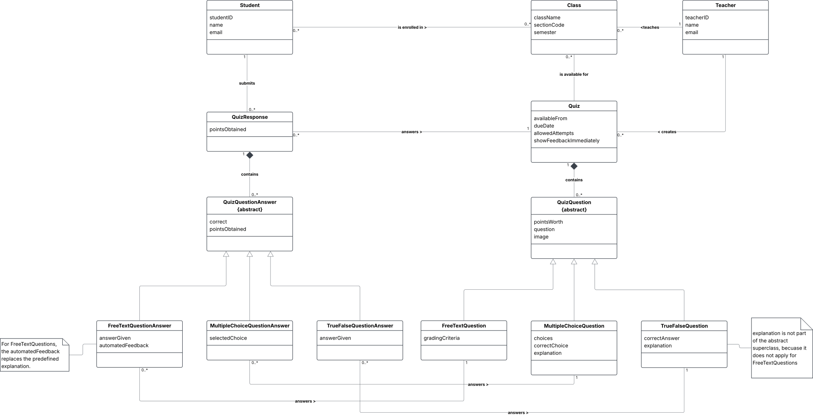

# D.3 Analysis

## 1. System Description
The problem of overly complicated and poorly organized online quiz creation and management affects teachers who create quizzes and students who use them for studying. Teachers spend unnecessary time creating, organizing, and reusing quiz content, while students receive limited feedback and experience accessibility and usability problems across devices. SimpleQuiz is an online quiz platform designed for teachers and students who want a simpler alternative to complicated quiz tools in learning management systems. Its value proposition is to simplify quiz creation and reuse for teachers while providing students with an accessible, student-focused experience across devices, reviewable answers, and clear feedback to support their learning.

## 2. Conceptual Model

## 3. Member participation

- Jonas Thumbs (@Jonas-Thumbs) - %:
- Cody Hess (@CodyHesss) - %:
- Bella Broker (@bjb629) - %:
- Gustavo Avina (@naugoose) - %:
- Annabelle Rodriguez (@annabellerod) - %:
- Gus Cardenas (@gusc839) - %:
