# D.4 Implementation 1

## 1. Introduction
**Description:**
SimpleQuiz is a collaborative, web-based quiz platform designed for educators, students, and trivia enthusiasts to easily create, share, take, and evaluate interactive quizzes. The system provides a seamless interface for users to build custom question sets, manage quiz sessions, and track performance metrics in real-time.
**Value Proposition:**  
SimpleQuiz streamlines the quiz creation and assessment lifecycle by offering a lightweight, intuitive, and responsive platform that bridges the gap between quiz creators and participants without the heavy bloat or complex licensing fees of commercial enterprise learning management systems.
**Minimum Viable Product (MVP) & Release Scope:**  
The MVP encompasses user authentication, quiz creation and editing (multiple choice, true/false), interactive quiz-taking sessions, and score tracking. In this first release (D4), we have successfully implemented the core FastAPI backend infrastructure, SQLModel relational database models, SQLite persistence layer, and initial frontend views (React, Vite, Clerk), delivering fully functional quiz creation and management workflows.
**Repository:**  
https://github.com/Jonas-Thumbs/SimpleQuiz

## 2. Implemented Requirements
### 2.1 Bella Broker — Create Quiz

- Pull requests: [https://github.com/Jonas-Thumbs/SimpleQuiz/pulls?q=is%3Apr+state%3Aclosed+author%3Abjb629](https://github.com/Jonas-Thumbs/SimpleQuiz/pulls?q=is%3Apr+state%3Aclosed+author%3Abjb629)
- Screenshot of GitHub page:  
  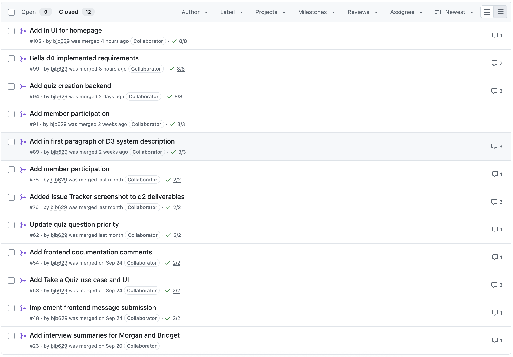
1. Requirement: As a user, I want to add questions and answer choices to a quiz so that I can tailor quizzes to specific learning objectives.
2. Issue Link: [#71 — Add Questions and Answer Choices to a Quiz](https://github.com/Jonas-Thumbs/SimpleQuiz/issues/71) 
3. Pull Request Link: [#94 — Create Quiz implementation](https://github.com/Jonas-Thumbs/SimpleQuiz/pull/94) 
4. Implemented by: Bella Broker
5. Reviewers: Annabelle Rodriguez
6. Automated Testing: Tests for the quiz creation backend are available in `backend/tests/test_quizzes.py`.
7. Visual Evidence:  
  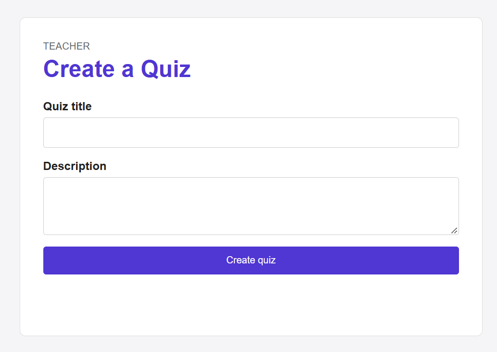
  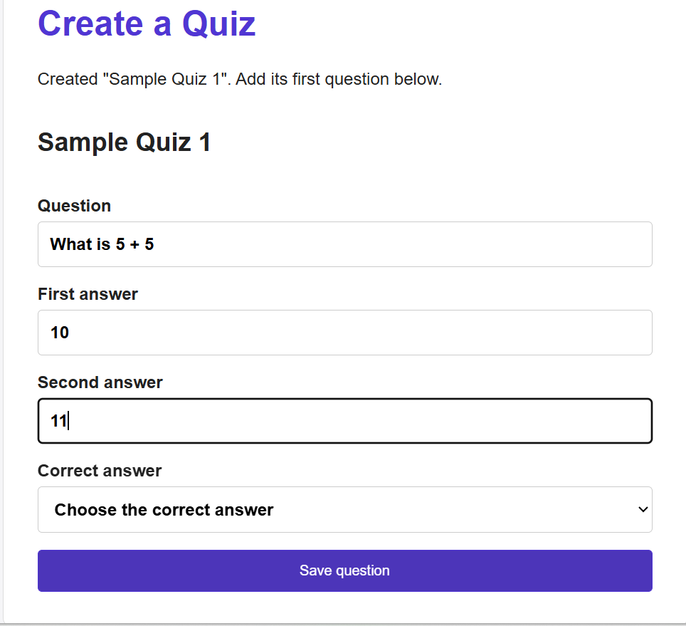
  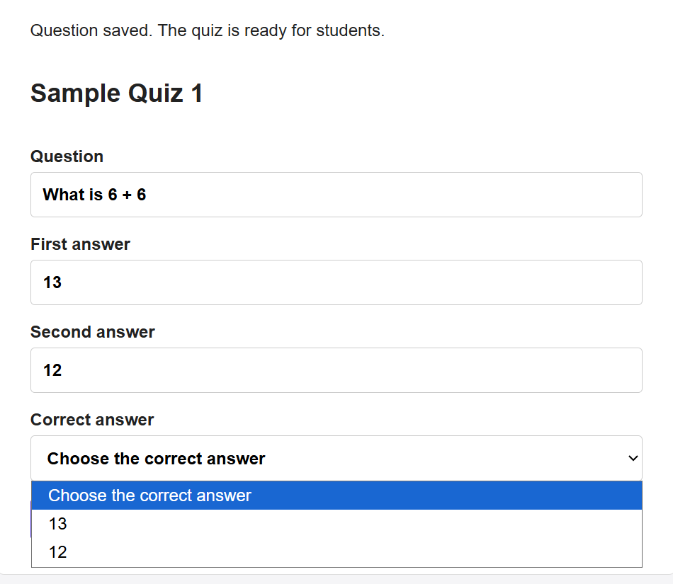

### 2.2 Jonas Thumbs

- Pull requests: [https://github.com/Jonas-Thumbs/SimpleQuiz/pulls?q=is%3Apr+author%3AJonas-Thumbs](https://github.com/Jonas-Thumbs/SimpleQuiz/pulls?q=is%3Apr+author%3AJonas-Thumbs)
- Screenshot of GitHub page:
  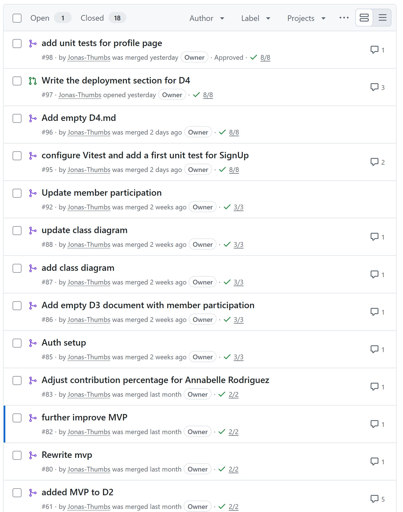
1. Requirement: As a user (teacher or student), I want to create an account and log in so that I can securely access my quizzes and data. _(Note: Originally, we wanted to implement different account types for students and teachers, but we no longer think this is necessary.)_
2. Issue Links:  
    [https://github.com/Jonas-Thumbs/SimpleQuiz/issues/74](https://github.com/Jonas-Thumbs/SimpleQuiz/issues/74)  
    [https://github.com/Jonas-Thumbs/SimpleQuiz/issues/73](https://github.com/Jonas-Thumbs/SimpleQuiz/issues/73)  
    _(Note: There are two links because we had separate issues for students and teachers at the time.)_
3. Pull Request Links:  
    https://github.com/Jonas-Thumbs/SimpleQuiz/pull/85 (Authentication)  
    https://github.com/Jonas-Thumbs/SimpleQuiz/pull/95 (Unit tests)
4. Author: Jonas Thumbs
5. Reviewers: Cody Hess for PR 85 and Gus Cardenas for PR 95
6. Automated Testing: https://github.com/Jonas-Thumbs/SimpleQuiz/blob/main/frontend/src/pages/SignUp.test.jsx
7. Visual Evidence:  
  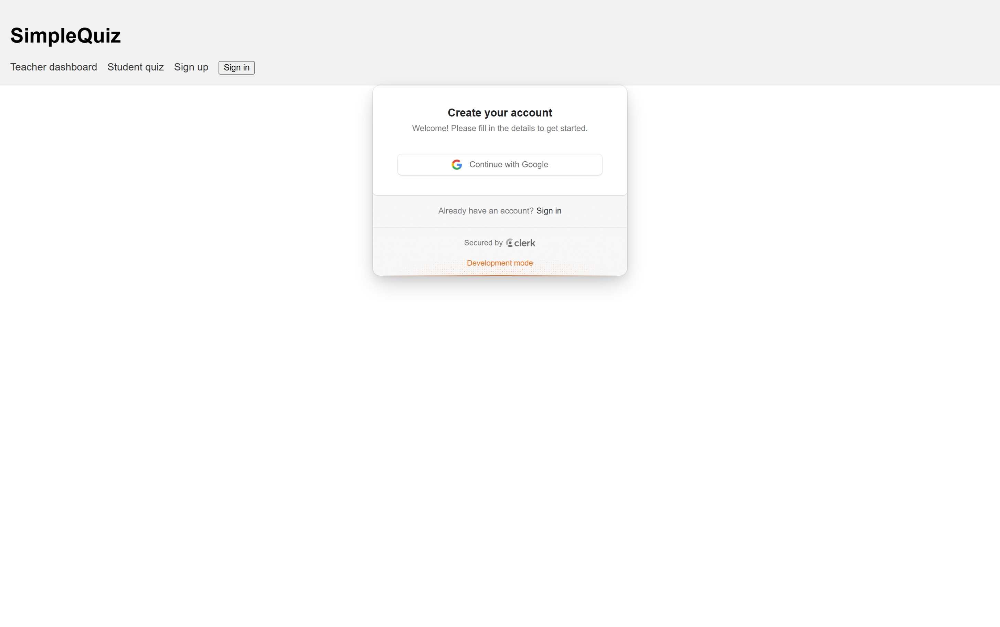

<!-- end of first list -->

1. Requirement: As an authenticated user, I want to log out of my session so that my data remains secure when I am finished using the application.
2. Issue Link: [https://github.com/Jonas-Thumbs/SimpleQuiz/issues/67](https://github.com/Jonas-Thumbs/SimpleQuiz/issues/67)
3. Pull Request Links:  
    https://github.com/Jonas-Thumbs/SimpleQuiz/pull/85 (Authentication)
4. Author: Jonas Thumbs
5. Reviewer: Cody Hess
6. Automated Testing: https://github.com/Jonas-Thumbs/SimpleQuiz/blob/main/frontend/src/App.test.jsx
7. Visual Evidence: _Not applicable_

### 2.3 Annabelle Rodriguez

- Pull requests: [https://github.com/Jonas-Thumbs/SimpleQuiz/pulls?q=is%3Apr+state%3Aopen+author%3Aannabellerod](https://github.com/Jonas-Thumbs/SimpleQuiz/pulls?q=is%3Apr+state%3Aopen+author%3Aannabellerod)
- Screenshot of GitHub page:  
  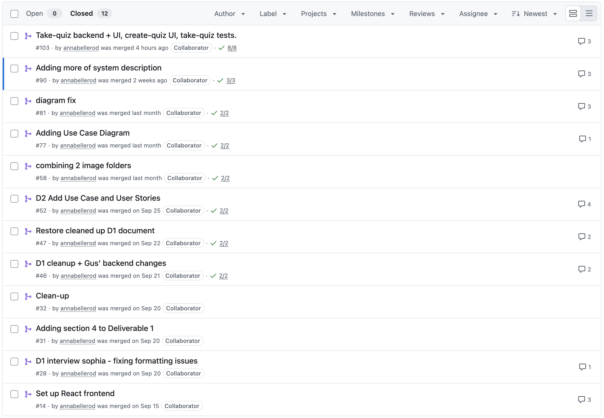
1. Requirement: As a student, I want to submit my completed quiz, so that I can get my answers graded.
2. Issue Link: [https://github.com/Jonas-Thumbs/SimpleQuiz/issues/70](https://github.com/Jonas-Thumbs/SimpleQuiz/issues/70) 
3. Pull Request Link: [https://github.com/Jonas-Thumbs/SimpleQuiz/pull/103](https://github.com/Jonas-Thumbs/SimpleQuiz/pull/103) 
4. Implemented by: Annabelle Rodriguez
5. Reviewers: Gus Cardenas
6. Automated Testing: [https://github.com/Jonas-Thumbs/SimpleQuiz/blob/main/backend/tests/test_take_quiz.py](https://github.com/Jonas-Thumbs/SimpleQuiz/blob/main/backend/tests/test_take_quiz.py)
7. Visual Evidence:  
  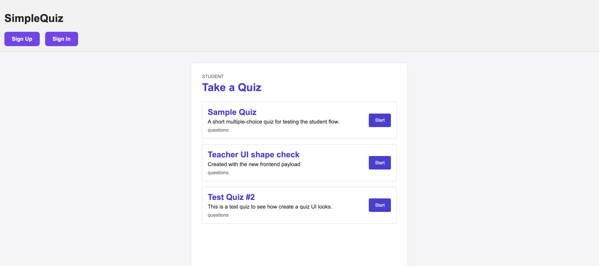
  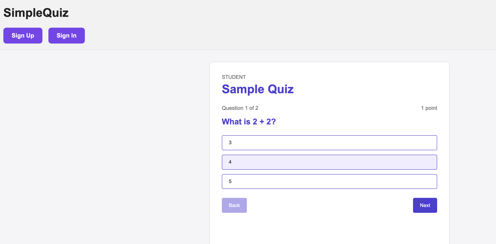
  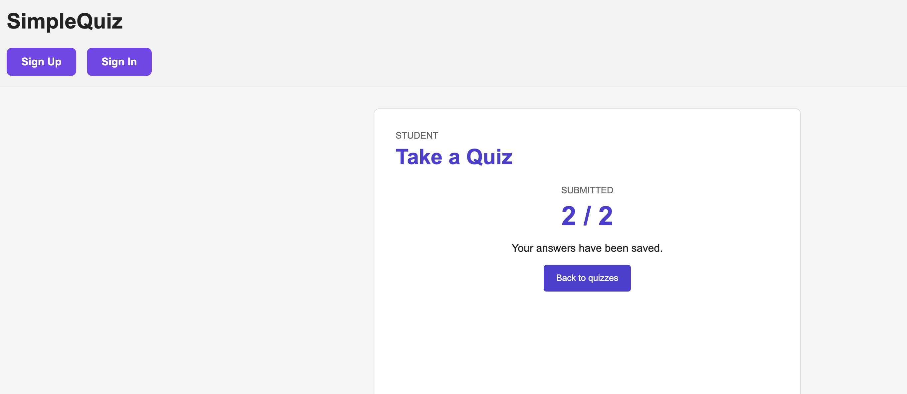

### 2.4 Gustavo Avina – Quiz Time Limit

* **GitHub Pull Requests Link:** https://github.com/Jonas-Thumbs/SimpleQuiz/pulls?q=is%3Apr+author%3Anaugoose
* **Screenshot of GitHub PRs:**
  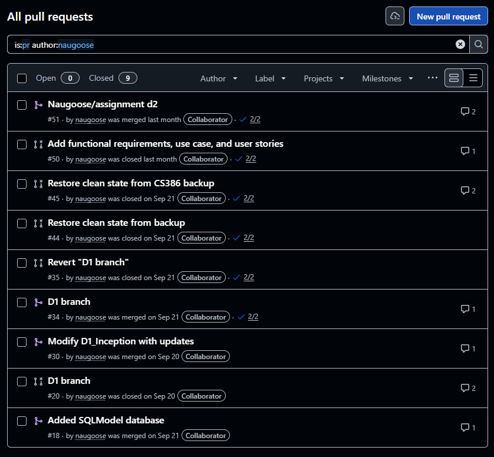
#### Requirement 1: Set Time Limit for Quizzes
1. **Requirement:** As a user, I want to set a time limit for quizzes so that students can be challenged.
2. **Issue Link:** https://github.com/Jonas-Thumbs/SimpleQuiz/issues/65
3. **Pull Request Link:** https://github.com/Jonas-Thumbs/SimpleQuiz/pull/100
4. **Implemented by:** Gustavo Avina
5. **Approved by:** Jonas Thumbs
6. **Automated Tests:** https://github.com/Jonas-Thumbs/SimpleQuiz/blob/main/frontend/src/pages/TeacherDashboard.test.jsx
7. **Visual Evidence:** 

    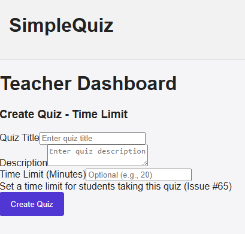

### 2.5 Gus Cardenas R

- Pull requests: [https://github.com/Jonas-Thumbs/SimpleQuiz/pulls?q=is%3Apr+author%3Agusc839](https://github.com/Jonas-Thumbs/SimpleQuiz/pulls?q=is%3Apr+author%3Agusc839)
- Screenshot of GitHub page:
  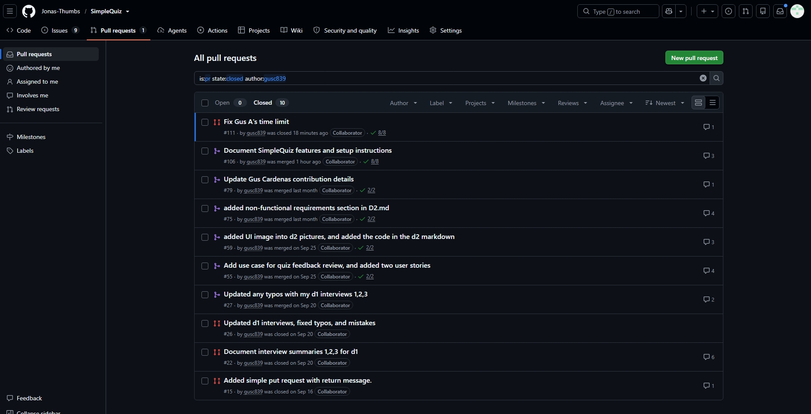

### 2.6 Cody Hess 

* **GitHub Pull Requests Link:** [https://github.com/Jonas-Thumbs/SimpleQuiz/pulls?q=is%3Apr+state%3Aclosed+author%3ACodyHesss](https://github.com/Jonas-Thumbs/SimpleQuiz/pulls?q=is%3Apr+state%3Aclosed+author%3ACodyHesss)
* **Screenshot of GitHub PRs:**
  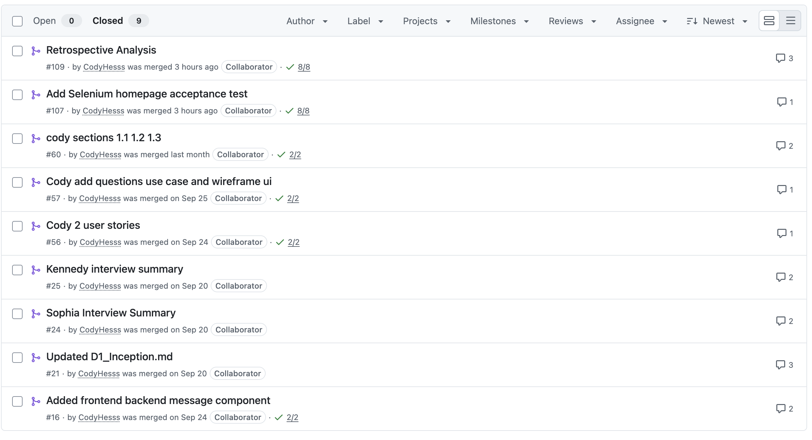

## 3. Automated Testing
1. **Testing frameworks:** We use `unittest` for the Python backend and `Vitest` for the frontend they were chosen because they are easy to work with and there's a lot of online documentation. For acceptance testing, we use `Selenium` because it can interact with the web browser like a human user. The backend tests cover activities like creating a quiz or saving an answer. The frontend tests verify that important UI components are present and behave as they should. The Selenium test verifies that the website loads without crashing. 
2. **Test Location:** The backend tests can be found [in this directory](https://github.com/Jonas-Thumbs/SimpleQuiz/tree/main/backend/tests). The frontend tests are co-located with their tested files in the [frontend/src](https://github.com/Jonas-Thumbs/SimpleQuiz/tree/main/frontend/src) directory. Selenium tests have their own [directory](https://github.com/Jonas-Thumbs/SimpleQuiz/tree/main/frontend/selenium). 
3. **Test Example**: The file [SignUp.test.jsx](https://github.com/Jonas-Thumbs/SimpleQuiz/blob/main/frontend/src/pages/SignUp.test.jsx) tests the file [SignUp.jsx](https://github.com/Jonas-Thumbs/SimpleQuiz/blob/main/frontend/src/pages/SignUp.jsx). The tests validates that the Clerk `SignUp` component is being rendered and the correct style is applied. 
4.  **Test Results**:
   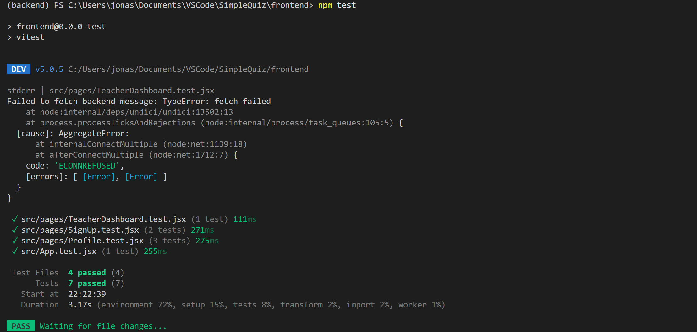
   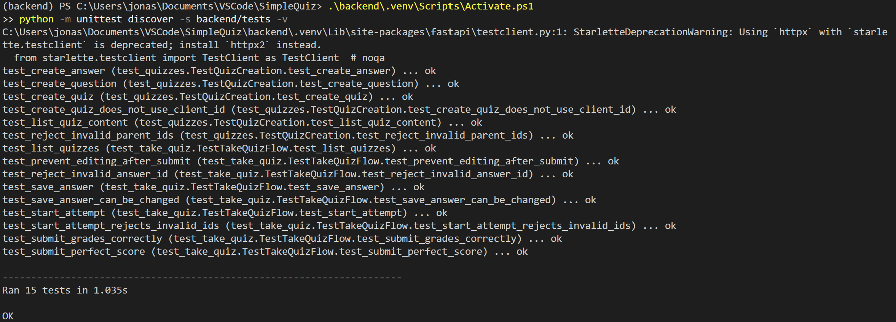
   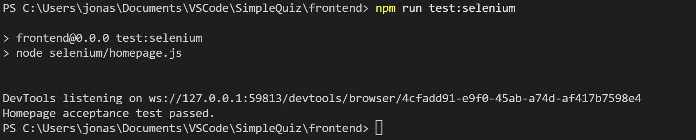
  
## 4. Technology Stack

### 4.1 FastAPI
* **Description:** A high-performance Python web framework used for building the core RESTful backend APIs, handling request validation, routing, and automatic OpenAPI documentation.
* **Justification:** Chosen over Flask or Django for its asynchronous performance, automatic interactive API docs (Swagger/ReDoc) via Pydantic validation, and seamless integration with modern Python type hints.
### 4.2 SQLModel
* **Description:** A library for interacting with SQL databases from Python, combining Pydantic and SQLAlchemy to provide data validation and ORM capabilities.
* **Justification:** Selected because it eliminates boilerplate code by unifying data validation models and database tables into single Python classes, ensuring type safety and seamless compatibility with FastAPI.
### 4.3 SQLite
* **Description:** A lightweight, file-based relational database management system used for persistent storage of user accounts, quizzes, questions, and scores.
* **Justification:** Ideal for an MVP and development phase because it requires zero server configuration, is self-contained within a single file, and integrates perfectly with SQLModel.
### 4.4 React, Vite & Clerk
* **Description:** React and Vite serve as the modern frontend framework and build tool for a fast, responsive single-page application experience, while Clerk handles user authentication and session management.
* **Justification:** Chosen for high performance, rapid hot module replacement, secure pre-built authentication components, and a clean component-driven architecture compared to older template rendering engines.

## 5. Learning Strategy
Our team learned the technologies needed for our SimpleQuiz project through documentation, tutorials, class materials, and hands on practice. We used these resources to understand how to build the application, implement features, and solve problems.

We shared knowledge by discussing implementation ideas, working together, and reviewing code through pull requests. This allowed team members to learn from one another and understand different aspects of the application, especially when some members were more familiar with certain technologies.

One challenge our team faced was managing other classwork and midterms while working on this project. Another barrier was deciding how to handle separate student and teacher roles. In the end, we decided to simplify the application by removing the separate roles so users can create and take quizzes. This helped reduce complexity and allowed us to focus on the main functionality of SimpleQuiz. We worked through problems by checking documentation, testing our changes, and communicating with teammates.

Learning took place throughout the project. Team members spent time learning new concepts, implementing features, reviewing code, and solving problems. The time investment varied between team members and depended on the complexity of each task ranging anywhere from 30 minutes for smaller tasks to four hours for larger more complex tasks.

## 6. Deployment
Our application is available publicly via the URL
[https://simple-quiz.duckdns.org](https://simple-quiz.duckdns.org).

The deployment was completed in five steps:
* Launching an Amazon EC2 instance (`t3.micro` running Ubuntu) on AWS, and enabling HTTP and HTTPS traffic.
* Logging into the instance via SSH and cloning the repository
* Building the frontend and backend as described in the repository documentation
* Installing and configuring Nginx as a reverse proxy. 
* Setting up our domain on DuckDNS, pointing to the public IP address of the EC2 instance and obtaining a free SSL certificate using the Let's Encrypt Certbot.  

AWS was chosen as a platform because it is reliable, provides a 183-day Free Tier, and allows us to host both the frontend and the backend on a single server.

## 7. Licensing
1. **Adopted License:** MIT License
2. **GitHub Configuration:** Configured by adding a standard `LICENSE` file to the root of the repository and enabling the license in the repository settings.
3. **Justification:** We chose the MIT License because it is a permissive open-source license that encourages collaboration, academic sharing, and community adoption with minimal legal restrictions, while protecting our team with standard liability disclaimers.

## 8. Repository Documentation
Here are the links to our project documentation on GitHub:

- **README:** https://github.com/Jonas-Thumbs/SimpleQuiz/blob/main/README.md
- **LICENSE:** https://github.com/Jonas-Thumbs/SimpleQuiz/blob/main/LICENSE
- **Version Tag (v0.1.0):** https://github.com/Jonas-Thumbs/SimpleQuiz/releases/tag/v0.1.0

## 9. User Interface Design
### 9.1 Design Approach
The SimpleQuiz user interface was designed to be simple, organized and easy to navigate. The goal is to help users create and access quizzes, and complete them without having a complex and confusing dashboard. The interface uses consistent colors, clear headings, and buttons to make all of the selections easy to find. The homepage displays the system and helps users to find the main features.  

### 9.2 Visual Examples
**Figure 1: SimpleQuiz Homepage** 

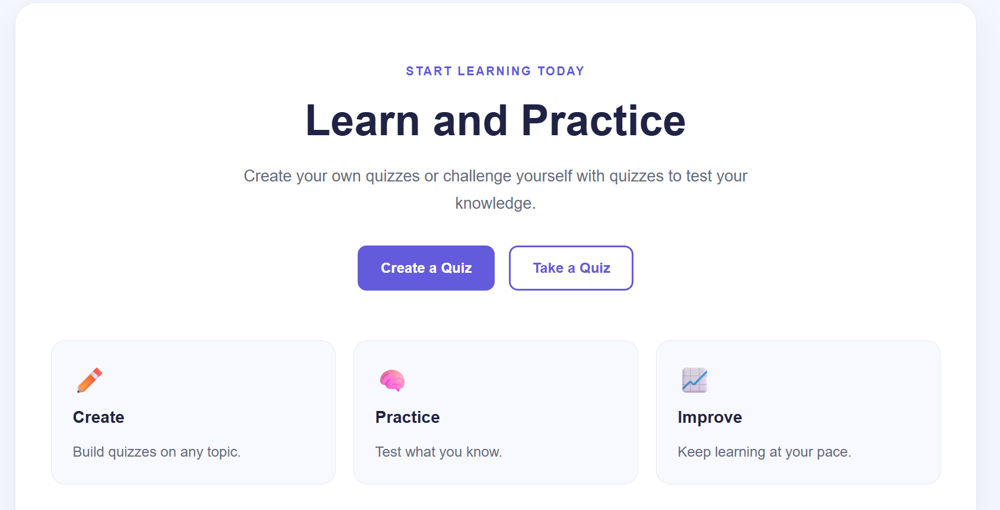

The homepage introduces SimpleQuiz and provides the user with a starting point to get their academic lessons jump started. 

**Figure 2: Navigation and Authentication**

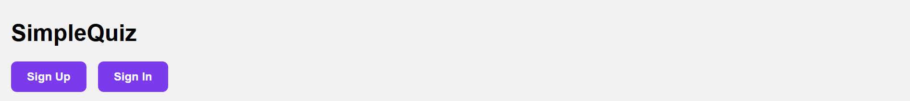

The navigation provides access to account related actions. The Sign In and Sign Up buttons use the same purple theme to keep the interface visually consistent. 

**Figure 3: Create a Quiz**

The Create a Quiz interface organizes the controls that users can use to create quizzes.

**Figure 4: Take a Quiz**

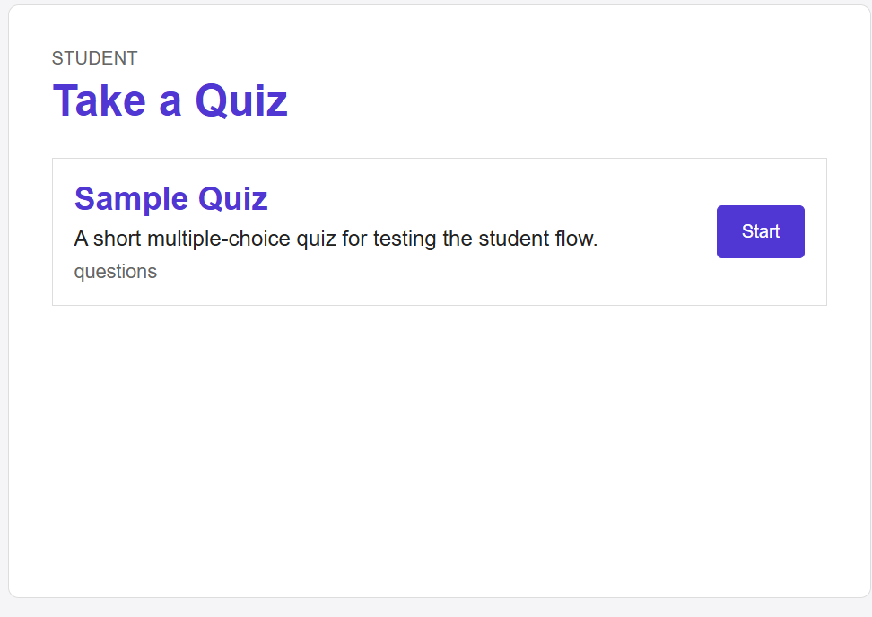

The Take a Quiz interface presents questions and answer choices clearly for users who are taking a quiz.

### 9.3 Usability Considerations
When coming up with the design for the interface, the name SimpleQuiz had a big part to play. To keep everything true to what the web application stands for, having a simple yet aesthetically appealing design was a must. The goal was to make the application easy to navigate while still maintaining a professional and consistent appearance.

The interface uses consistent colors, clear headings, and easy to recognize buttons to help users understand where to go and what actions they can take. The Create a Quiz interface is designed to make creating quizzes straightforward, while the Take a Quiz interface focuses on presenting questions and answer choices clearly for students. Separating these features based on the user's needs helps make the application more organized and easier to use.

Overall, the design focuses on balancing appearance with functionality so that all users can use SimpleQuiz without unnecessary confusion.

## 10. Retrospective Analysis

### 10.1 Key Learnings

Our team learned how Selenium and Vitest can be used to automate testing in a real web browser. We created a simple test that opens the SimpleQuiz homepage, locates the main heading, and verifies that it displays the expected text. This helped us understand the basic Selenium and Vitest workflow. We also learned that acceptance tests can verify the application from a user’s perspective, while our existing Vitest tests focus on individual React components.

### 10.2 Challenges Overcome

One challenge was deciding which feature to test first. A complete quiz workflow would require the frontend, backend, database, and authentication system to run together, making the test a lot more complicated. We solved this by beginning with a small homepage test that only checks visible content. We also ran into several merge conflicts while combining everyone’s code, which took extra time to resolve. We also needed to account for requirements such as running the Vite development server, having Chrome installed, and providing the Clerk environment variable. Keeping the first test small made Selenium easier for the team to learn and gave us a foundation for more advanced tests.

### 10.3 Future Improvements

In the future, we plan to expand our Selenium and Vitest testing beyond the homepage. Possible tests could include navigating to the quiz creation page, completing the quiz form, taking a quiz, and confirming that the final score is displayed correctly. We also plan to add the test to a GitHub Actions workflow so it runs automatically when changes are submitted. As the number of tests grows, we will add reusable setup functions and reliable element selectors to keep the tests clear and maintainable.

## 11. System Demonstration
Video Link: [https://youtu.be/nK3SiBe20Us](https://youtu.be/nK3SiBe20Us)
