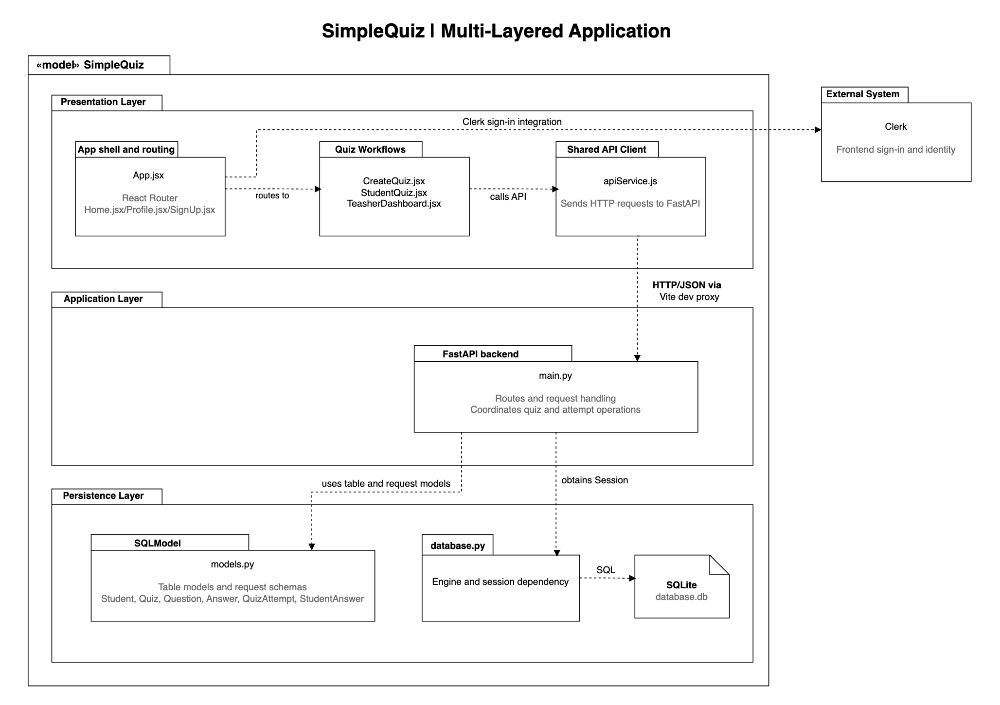
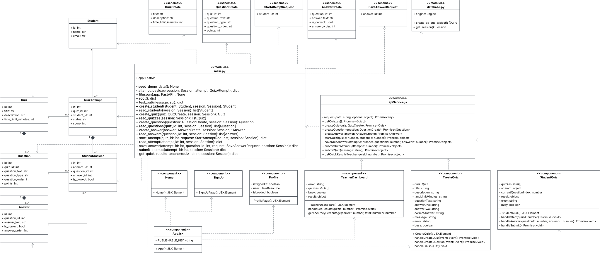
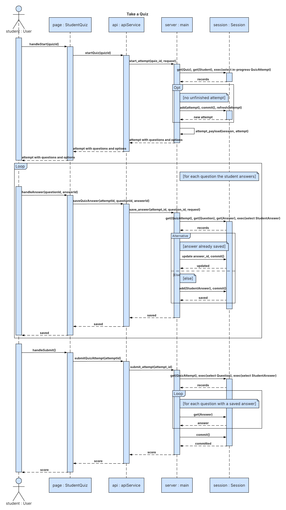
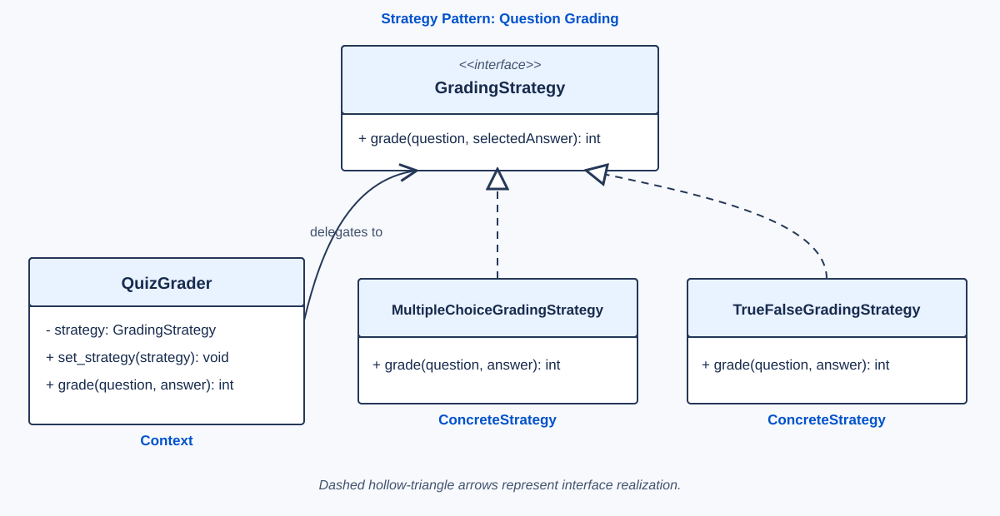
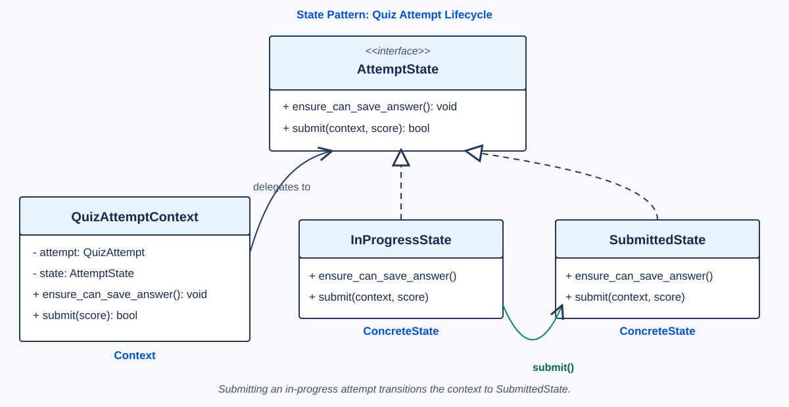

# D.5 Design

## 1. Description
SimpleQuiz is an online quiz platform designed for teachers and students who want a simpler way to create and take quizzes. Creating and managing quizzes can be time consuming, especially when teachers need to organize questions and answer choices. SimpleQuiz aims to make this process easier by providing a straightforward platform for creating and accessing quizzes.

The current version of SimpleQuiz focuses on creating multiple choice quizzes. Teachers can create and save quizzes, add multiple questions to each quiz, provide answer choices, and display the correct answer for each question. These features establish the core functionality of the system and provide a foundation for future improvements to the quiz-taking experience for students.

## 2. Architecture

SimpleQuiz uses a layered web architecture. The React frontend presents quiz creation, quiz-taking, and teacher-results workflows and calls a shared API client. The client sends HTTP/JSON requests to a FastAPI backend, whose route handlers validate requests and coordinate quiz and attempt operations. SQLModel maps persistent records to SQLite, and FastAPI receives database sessions through a shared dependency. Clerk supplies the frontend sign-in experience and user identity.

### UML Package Diagram

The diagram follows the nested package structure. It shows the concrete modules in each layer, the external Clerk integration, and the request path through environment-specific routing infrastructure.

### Rationale

The layers separate responsibilities, which supports **maintainability**: React pages handle presentation, FastAPI routes handle HTTP requests and application operations, and the database module owns engine and session setup. A shared API client keeps request details out of individual page components.

In the current implementation, `backend/models.py` contains both SQLModel table models and request schemas. The schemas serve the API layer but are co-located with the table models in the code.

The boundaries also support **testability**. Backend tests override FastAPI's session dependency with an in-memory SQLite database, while frontend component tests mock API functions. This lets each side be tested without requiring a complete deployed system.

SQLite is a **simple and adequate performance** choice for the current MVP because it needs no separate database server. If usage grows, the database connection can be changed to a server database without moving UI behavior into the persistence layer.

**Alternative considered:** A single server-rendered application could combine page rendering, API handling, and database access, reducing the number of runtime components. We kept React with a FastAPI API because the student page needs to keep track of the current question and selected answer as the student moves through the quiz. React updates the page immediately, while FastAPI saves the answer. The separate frontend and backend can also be developed and tested independently. This approach adds an HTTP boundary and separate tooling.

## 3. Class Diagram

This diagram reflects the `main` branch of the repository as of commit [48cf3d7](https://github.com/Jonas-Thumbs/SimpleQuiz/commit/48cf3d7). Subsequent additions to the codebase are not modeled.

## 4. Sequence Diagram

**Use case:** Take a Quiz

- **Actor:** Student
- **Goal:** Take a quiz and receive a score.
- **Preconditions:** The student has an account and the quiz exists with at least one question. 
- **Trigger:** The student clicks Start on a quiz.
- **Postconditions:** The attempt is marked submitted with all questions answered, the score is totaled. 

**Main flow**

1. The student chooses a quiz and starts it.
2. The system looks for the student's unfinished attempt on this quiz. If there is none, it creates a new attempt.
3. The system shows each question with its answer options. Correct answers are not shown.
4. For each question, the student chooses an option and the system saves it.
5. The student submits the quiz.
6. The system grades each saved answer, adds up the points, marks the attempt as completed, and shows the total score.

**Alternative flows**

- **2a.** The student leaves without submitting. The attempt is not graded, and the student receives a score of 0.
- **4a.** The student does not finish the quiz within the time limit. The attempt is recorded, but receives a score of 0.
- **6a.** A question left unanswered earns no points.

## 5. Design Patterns

### 5.1 Strategy Pattern: Question Grading

Different question types need different grading rules. The Strategy pattern keeps each grading rule in a separate class and selects the correct rule when a quiz is submitted.

Pattern roles and implementation links:

- **Context — [`QuizGrader`](https://github.com/Jonas-Thumbs/SimpleQuiz/blob/185269cf75e54260b759d5c52819f360c8aa75e8/backend/grading.py#L39):** Uses a grading strategy.
- **Strategy — [`GradingStrategy`](https://github.com/Jonas-Thumbs/SimpleQuiz/blob/185269cf75e54260b759d5c52819f360c8aa75e8/backend/grading.py#L8):** Defines the common grading method.
- **Concrete strategies — [`MultipleChoiceGradingStrategy`](https://github.com/Jonas-Thumbs/SimpleQuiz/blob/185269cf75e54260b759d5c52819f360c8aa75e8/backend/grading.py#L16) and [`TrueFalseGradingStrategy`](https://github.com/Jonas-Thumbs/SimpleQuiz/blob/185269cf75e54260b759d5c52819f360c8aa75e8/backend/grading.py#L25):** Grade each question type.
- **Client — [`submit_attempt`](https://github.com/Jonas-Thumbs/SimpleQuiz/blob/185269cf75e54260b759d5c52819f360c8aa75e8/backend/main.py#L326):** Selects and uses the strategy.

### 5.2 State Pattern: Quiz Attempt Lifecycle

A quiz attempt allows different actions depending on its status. The State pattern allows answers while an attempt is in progress and prevents changes after it is submitted.

Pattern roles and implementation links:

- **Context — [`QuizAttemptContext`](https://github.com/Jonas-Thumbs/SimpleQuiz/blob/185269cf75e54260b759d5c52819f360c8aa75e8/backend/attempt_state.py#L47):** Holds the attempt's current state.
- **State — [`AttemptState`](https://github.com/Jonas-Thumbs/SimpleQuiz/blob/185269cf75e54260b759d5c52819f360c8aa75e8/backend/attempt_state.py#L12):** Defines the state-dependent actions.
- **Concrete states — [`InProgressState`](https://github.com/Jonas-Thumbs/SimpleQuiz/blob/185269cf75e54260b759d5c52819f360c8aa75e8/backend/attempt_state.py#L24) and [`SubmittedState`](https://github.com/Jonas-Thumbs/SimpleQuiz/blob/185269cf75e54260b759d5c52819f360c8aa75e8/backend/attempt_state.py#L37):** Allow or reject actions based on status.
- **Clients — [`save_answer` and `submit_attempt`](https://github.com/Jonas-Thumbs/SimpleQuiz/blob/185269cf75e54260b759d5c52819f360c8aa75e8/backend/main.py#L280):** Use the context when saving or submitting.

## 6. Design Principles
1. Single Responsibility Principle (SRP)
* **Explanation:** A class or module should have only one reason to change, separating distinct system concerns.
* **Code Example:** We separated database schema definitions from API routing by keeping data models in [models.py](https://github.com/Jonas-Thumbs/SimpleQuiz/blob/main/backend/models.py) and endpoint request handlers in [main.py](https://github.com/Jonas-Thumbs/SimpleQuiz/blob/main/backend/main.py).
* **Benefit:** Encapsulating database structures in models.py separates data persistence from HTTP request handling; while modifying a data model intentionally updates the endpoints that return it, routing logic and transport rules remain cleanly decoupled from database layout definitions.

2. Don't Repeat Yourself (DRY)
* **Explanation:** Every piece of logic should have a single authoritative representation to eliminate code duplication.
* **Code Example:** Instead of duplicating database session boilerplate across endpoints, we centralized session lifecycle management into a single get_session dependency function in [database.py](https://github.com/Jonas-Thumbs/SimpleQuiz/blob/main/backend/database.py).
* **Benefit:** Updating connection settings or migrating databases only requires changing code in one central location.
