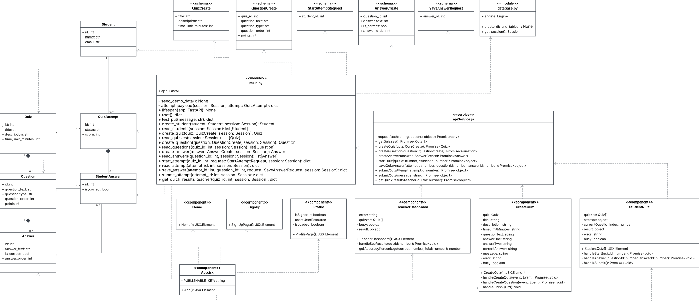

# D.5 Design

## 1. Description

## 2. Architecture

## 3. Class Diagram

This diagram reflects the `main` branch of the repository as of commit [48cf3d7](https://github.com/Jonas-Thumbs/SimpleQuiz/commit/48cf3d7). Subsequent additions to the codebase are not modeled.

## 4. Sequence Diagram

## 5. Design Patterns

## 6. Design Principles
1. Single Responsibility Principle (SRP)
* **Explanation:** A class or module should have only one reason to change, separating distinct system concerns.
* **Code Example:** We separated database schema definitions from API routing by keeping data models in [models.py](https://github.com/Jonas-Thumbs/SimpleQuiz/blob/main/backend/models.py) and endpoint request handlers in [main.py](https://github.com/Jonas-Thumbs/SimpleQuiz/blob/main/backend/main.py).
* **Benefit:** Encapsulating database structures in models.py separates data persistence from HTTP request handling; while modifying a data model intentionally updates the endpoints that return it, routing logic and transport rules remain cleanly decoupled from database layout definitions.

2. Don't Repeat Yourself (DRY)
* **Explanation:** Every piece of logic should have a single authoritative representation to eliminate code duplication.
* **Code Example:** Instead of duplicating database session boilerplate across endpoints, we centralized session lifecycle management into a single get_session dependency function in [database.py](https://github.com/Jonas-Thumbs/SimpleQuiz/blob/main/backend/database.py).
* **Benefit:** Updating connection settings or migrating databases only requires changing code in one central location.
