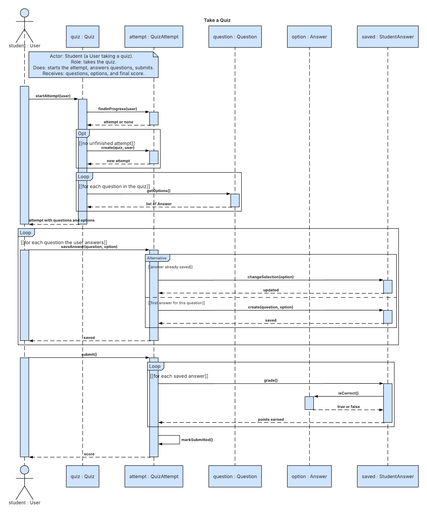

# D.5 Design

## 1. Description

## 2. Architecture

## 3. Class Diagram

## 4. Sequence Diagram

**Use case:** Take a Quiz

- **Actor:** Student
- **Goal:** Take a quiz and receive a score.
- **Preconditions:** The student has an account and the quiz exists with at least one question. 
- **Trigger:** The student clicks Start on a quiz.
- **Postconditions:** The attempt is marked submitted with all questions answered, the score is totaled. 

**Main flow**

1. The student chooses a quiz and starts it.
2. The system looks for the student's unfinished attempt on this quiz. If there is none, it creates a new attempt.
3. The system shows each question with its answer options. Correct answers are not shown.
4. For each question, the student chooses an option and the system saves it.
5. The student submits the quiz.
6. The system grades each saved answer, adds up the points, marks the attempt as completed, and shows the total score.

**Alternative flows**

- **2a.** The student leaves without submitting. The attempt is not graded, and the student receives a score of 0.
- **4a.** The student does not finish the quiz within the time limit. The attempt is recorded, but receives a score of 0.
- **6a.** A question left unanswered earns no points.

## 5. Design Patterns

## 6. Design Principles
1. Single Responsibility Principle (SRP)
* **Explanation:** A class or module should have only one reason to change, separating distinct system concerns.
* **Code Example:** We separated database schema definitions from API routing by keeping data models in [models.py](https://github.com/Jonas-Thumbs/SimpleQuiz/blob/main/backend/models.py) and endpoint request handlers in [main.py](https://github.com/Jonas-Thumbs/SimpleQuiz/blob/main/backend/main.py).
* **Benefit:** Encapsulating database structures in models.py separates data persistence from HTTP request handling; while modifying a data model intentionally updates the endpoints that return it, routing logic and transport rules remain cleanly decoupled from database layout definitions.

2. Don't Repeat Yourself (DRY)
* **Explanation:** Every piece of logic should have a single authoritative representation to eliminate code duplication.
* **Code Example:** Instead of duplicating database session boilerplate across endpoints, we centralized session lifecycle management into a single get_session dependency function in [database.py](https://github.com/Jonas-Thumbs/SimpleQuiz/blob/main/backend/database.py).
* **Benefit:** Updating connection settings or migrating databases only requires changing code in one central location.
